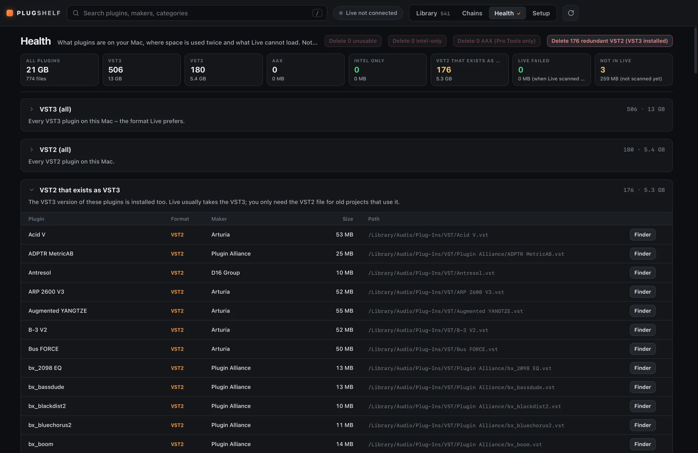

# PlugShelf

A plugin library for the Mac that loads plugins, signal chains and Ableton racks straight into Ableton Live.
An independent rebuild of the core of RONE VST MANAGER, plus a chain builder of its own.

<p>
  <a href="docs/screenshots/library.webp"></a>
  <a href="docs/screenshots/chains.webp"></a>
  <a href="docs/screenshots/health.webp"></a>
</p>

## Features

- **Library** – finds every installed plugin (VST3, AU, VST2, CLAP, AAX) and shows one tile per plugin with a
  picture of its editor. Search, categories, makers, formats, favourites, collections, racks, recently loaded.
  One click (or Enter) loads a plugin onto Live's selected track.
- **Only what runs** – uses versions that run natively on this Mac and that Live accepts (no Intel-only files on
  Apple Silicon, no AAX, nothing Live's own scan rejected), VST3 first.
- **Plugin pictures** – PlugShelf opens each plugin briefly in its own mini host (VST3, VST2, AU) and captures the
  editor; each capture runs in a separate process, so a crashing plugin never takes the app down.
- **Chains** – 167 signal-chain templates in 12 categories and 6 genres: vocals, drums, bass, mix bus, mastering,
  UAD/Apollo chains, dub techno, and 100 **Famous Chains** of well-known records, engineers and mastering rooms
  (e.g. "Michael Jackson – Thriller": Neve 1084 → 1176). A slot that names hardware takes your emulation of it,
  otherwise a comparable plugin marked "Stand-in". Two dice: *Roll plugins* swaps plugins within their role,
  *New chain* builds a new layout.
- **Ableton racks** – a chain becomes an Audio Effect Rack (`.adg`) with named macros: the settings a chain leaves
  to taste first, every compressor/limiter/clipper threshold always, documented values as starting points.
  Saved to the User Library or loaded straight onto the selected track.
- **Health** – disk use, VST2 copies next to a VST3, AAX without Pro Tools, Intel-only, broken bundles, Live scan
  failures. Nothing is deleted; "Finder" shows the file.

## Build and run

```bash
./scripts/build.sh
ditto --noextattr build/PlugShelf.app /Applications/PlugShelf.app
```

`build.sh` builds a universal app (Apple Silicon + Intel). It signs with your Apple Development / Developer ID
certificate if there is one, so macOS keeps privacy permissions across builds, otherwise ad hoc. It signs in a
temp folder because iCloud Drive stamps Finder info onto bundles, which codesign refuses.

Development without the window (page at http://127.0.0.1:47900/):

```bash
swift build -c release && .build/release/PlugShelf --headless
```

## Connect Ableton Live

1. PlugShelf → **Setup** → **Install script** (copies `ableton/PlugShelf` to `<User Library>/Remote Scripts`).
2. Restart Live once, then Settings → Link, Tempo & MIDI → Control Surface → **PlugShelf** (input/output: None).
3. **Test connection** – the indicator turns green.

The script listens on UDP `127.0.0.1:47812`; script updates reach a running Live without a restart.

## Layout

| Part | Files |
| --- | --- |
| App, window, local HTTP server, API | `Sources/PlugShelf/main.swift`, `HTTPServer.swift`, `API.swift` |
| Scanner, names and categories, Live's plugin database | `Scanner.swift`, `Classify.swift`, `LiveDB.swift` |
| Live connection, user data | `Ableton.swift`, `Store.swift` |
| Pictures, plugin parameters (helper processes) | `Thumbs.swift`, `Capture.swift`, `Params.swift` |
| Racks: macros, starting values, `.adg` writer | `Racks.swift`, `RackWriter.swift`, `RackTemplates.swift` |
| Mini host for VST3 / VST2 (C) | `Sources/CPlugHost/` |
| Page | `web/index.html`, `web/app.css`, `web/app.js` |
| Chains: roles, categories, templates, tab | `web/chain-data.js`, `web/chain-famous.js`, `web/chains.js` |
| Live script | `ableton/PlugShelf/__init__.py`, `ops.py` |

Data lives in `~/Library/Application Support/PlugShelf/`.

## Not in yet

Global hotkeys and mouse ring, compact side strip, MIDI library, insights, phone remote, Stream Deck.
