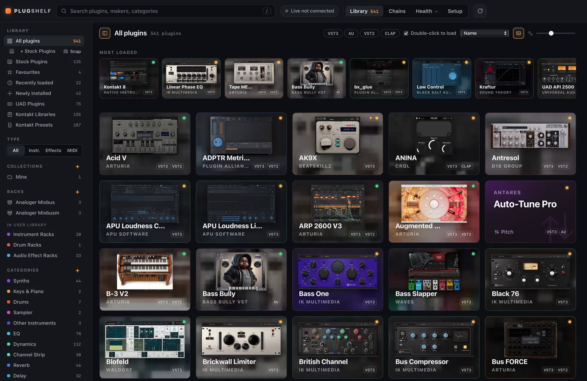
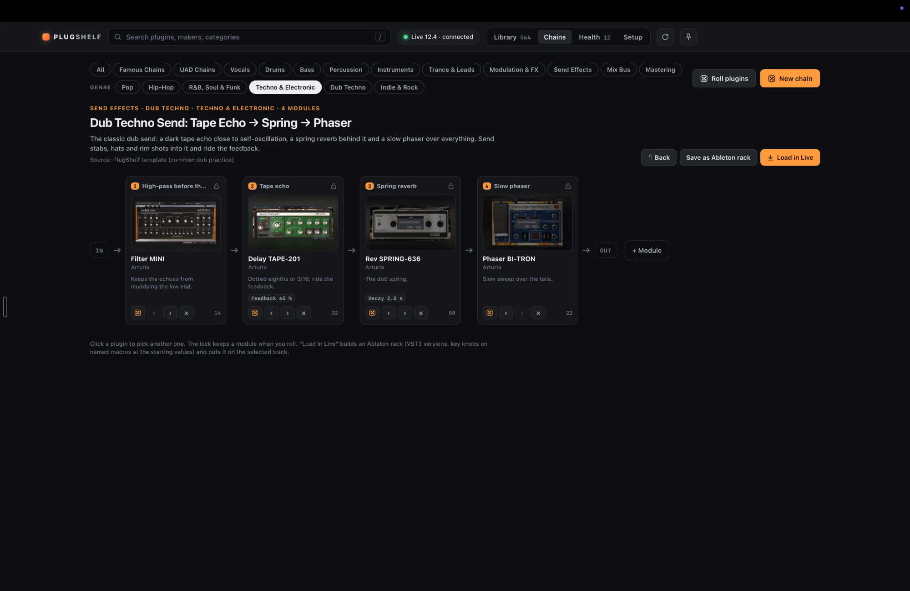

# PlugShelf

PlugShelf is a macOS plugin manager and chain builder for Ableton Live. It finds installed audio plugins,
organizes them in a searchable library, loads plugins onto Live's selected track, and creates effect,
mix-bus, mastering, and famous-recording chains.

<p>
  <a href="docs/screenshots/library.webp"></a>
  <a href="docs/screenshots/chains.webp"></a>
  <a href="docs/screenshots/health.webp"></a>
</p>

## Download and install (for users)

**You do not need Swift, Xcode, Python, Node.js, Homebrew, or any other developer tool.**

### Requirements

| Required | Details |
| --- | --- |
| macOS | macOS 13 Ventura or later |
| Mac | Apple Silicon and Intel are supported |
| Ableton Live | Required for loading plugins and racks into a track; the library and chain browser can open without Live |
| Audio plugins | PlugShelf manages plugins already installed on the Mac; it does not include commercial plugins |

### Install the ready-to-run app

1. Open the [latest release](../../releases/latest) and download **`PlugShelf-…-mac.zip`** under **Assets**.
   Do **not** use GitHub's **Code → Download ZIP** button; that downloads source code for developers.
2. Double-click the downloaded ZIP file.
3. Drag **PlugShelf.app** into the **Applications** folder.
4. Open PlugShelf.

PlugShelf is not yet notarized by Apple, so macOS requires one manual confirmation on first launch:

- **macOS 15 Sequoia or later:** click **Done**, then open **System Settings → Privacy & Security**, scroll
  down, click **Open Anyway** next to PlugShelf, and confirm.
- **macOS 13–14:** Control-click or right-click PlugShelf in Applications, choose **Open**, then **Open** again.

If macOS reports that the app is damaged, open Terminal and run this once:

```bash
xattr -dr com.apple.quarantine /Applications/PlugShelf.app
```

### Connect Ableton Live

1. Open PlugShelf and go to **Setup → Install script**.
2. Restart Live once.
3. In Live, open **Settings → Link, Tempo & MIDI** and select **PlugShelf** as a Control Surface.
   Leave Input and Output set to **None**.
4. Return to PlugShelf and choose **Test connection**. The indicator should turn green.

The small Python control-surface script runs inside Ableton Live's own environment. Users do not install or
configure Python themselves.

## Features

- **Plugin library** – finds installed VST3, AU, VST2, CLAP, and AAX plugins and shows one tile per plugin.
  Search by name, category, maker, format, favourites, collections, racks, or recently loaded plugins.
- **Only what runs** – prefers formats that run natively on the current Mac and that Live accepts: VST3 first,
  no Intel-only plugins on Apple Silicon, no AAX in Live, and no plugins rejected by Live's scan.
- **Plugin pictures** – opens supported plugin editors briefly in isolated helper processes and captures a
  thumbnail. A crashing plugin does not take down the main app.
- **Chains** – includes 167 templates in 12 categories and 6 genres: vocals, drums, bass, mix bus, mastering,
  UAD/Apollo chains, dub techno, and 100 Famous Chains based on well-known records, engineers, and mastering
  rooms. Hardware names are matched to an installed emulation or a comparable stand-in.
- **Ableton racks** – turns a chain into an Audio Effect Rack (`.adg`) with named macros and starting values,
  saves it in the User Library, and can load it onto the selected track.
- **Plugin health** – reports disk use, redundant VST2/VST3 installs, AAX without Pro Tools, Intel-only and
  broken bundles, and Live scan failures. PlugShelf does not delete plugin files.

PlugShelf stores its user data in `~/Library/Application Support/PlugShelf/`.

## For developers

Building from source requires the Swift toolchain. Normal users do not build the app and can ignore all source
folders in this repository.

See **[DEVELOPMENT.md](DEVELOPMENT.md)** for prerequisites, build commands, release verification, signing, and
the source layout.

| Repository path | Audience | Purpose |
| --- | --- | --- |
| `Sources/`, `Package.swift` | Developers | Swift and C application source |
| `web/` | Developers | Web interface bundled into the finished app |
| `ableton/` | Developers | Control-surface source bundled into the app and installed from **Setup** |
| `scripts/` | Developers/release maintainers | Build and release-verification tools |
| `docs/` | Documentation | Screenshots and other documentation assets |

## Not in yet

Global hotkeys and mouse ring, compact side strip, MIDI library, insights, phone remote, and Stream Deck support.
